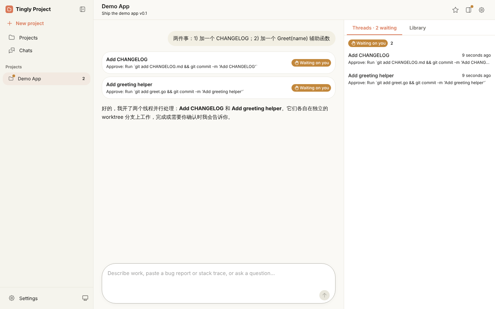

# tingly-project

[English](README.md) · **简体中文**

一个在本地运行的多线程编码 Agent 工作台。你只需要在项目对话里和一个
**协调者（Coordinator）** 交流，它会把工作拆成多个并行的 **线程（Thread）**：
每个线程都是一个独立的 Claude Code 会话，运行在自己的 git worktree 和分支上。
哪些已经可以评审、哪些在等你处理，协调者都会及时告诉你。

它的工作方式借鉴了"项目 + 线程"式的 AI 协作体验，是基于
[Tingly Box](https://github.com/tingly-dev/tingly-box) 的独立开源实现，完全运行在你自己的机器上。



## 功能

- **一个入口收下所有工作。** 把任务清单、bug 报告或错误堆栈直接贴进对话。
  简单的问题协调者当场回答；其他任务每项开一个线程；后续追问会转给正在处理它的线程。
- **每个线程都是真实的 Claude Code 会话**，有自己的 worktree 和分支，线程之间互不干扰。
  权限请求和提问会在线程里等你处理。
- **概览（Overview）** 按状态分组展示线程：等你处理、待评审、进行中、空闲、已完成。
  可以直接在这里查看线程的 diff，并合并回它的基础分支。
- **常驻上下文**：一句话目标（Goal）、项目说明（Instructions）、记忆文件
  （`MEMORY.md`，以及 Claude 写下、你也能编辑的笔记）和共享文件库（Library），
  每个线程都能用到。
- **本地运行、多模型。** 线程跑在你的机器上；借助 Tingly Box，协调者和线程可以使用不同的模型。

## 快速开始

需要 `git` 和 [Claude Code CLI](https://docs.claude.com/en/docs/claude-code)（`claude` 在 `PATH` 中）。

```bash
task build                 # 构建前端界面和二进制
./bin/tingly-project       # 打开 http://127.0.0.1:12590
```

默认情况下，协调者和线程通过本地 Tingly Box 访问模型，地址为
`http://localhost:12580/tingly/anthropic`。在 **设置（Settings）** 里粘贴 Tingly Box
的模型 token、选择默认模型并发送一条测试消息即可。也可以改为任意兼容 Anthropic API
的接口；OpenAI 风格的接口可用于协调者和普通对话，此时线程会改用 Claude Code 自身的登录。

想在没有模型 key 的情况下体验完整流程？运行脚本化的
[端到端演示](showcase/e2e-demo/README.md)：发一条消息，两个线程并行工作，评审 diff，合并。

## 数据存放位置

所有数据保存在 `~/.tingly-project`（可用 `--data-dir` 或 `$TINGLY_PROJECT_HOME` 修改）。
每个项目的记忆、文件库和线程 worktree 都在 `projects/<id>/` 下。

服务只监听 `127.0.0.1`，且没有登录鉴权，请在可信的机器上使用，不要对外暴露端口。

## 开发

```bash
task dev:backend    # API，端口 :12590
task dev:frontend   # Vite，端口 :3010，代理 /api
task test           # go vet + go test + 类型检查 + lint + vitest
task codegen        # 修改 API 模型或路由后执行
```

| 层 | 技术栈 |
|---|---|
| 后端 | Go、gin、[`tingly-box/swagger`](https://github.com/tingly-dev/tingly-box/tree/main/swagger) 路由分组、gorm + SQLite、用于驱动 Claude Code 的 [`tingly-box/agentboot`](https://github.com/tingly-dev/tingly-box/tree/main/agentboot)、Anthropic / OpenAI Go SDK |
| 前端 | React 19、MUI、Vite、`openapi-typescript` + `openapi-fetch`、Tabler 图标、i18next（中 / 英） |

背景调研：[`.research/claude-projects.md`](.research/claude-projects.md) ·
设计文档：[`.design/projects.md`](.design/projects.md)

## 免责声明

tingly-project 是独立的社区项目，与 Anthropic 没有任何关联，也未获得其认可或赞助。
Claude 和 Claude Code 是 Anthropic, PBC 的商标，本文提及它们仅用于说明本项目所配合使用的工具。

## 许可证

[Mozilla Public License 2.0](LICENSE)
