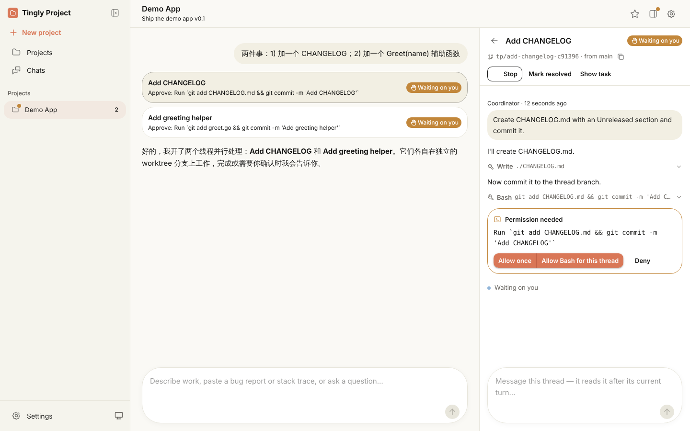
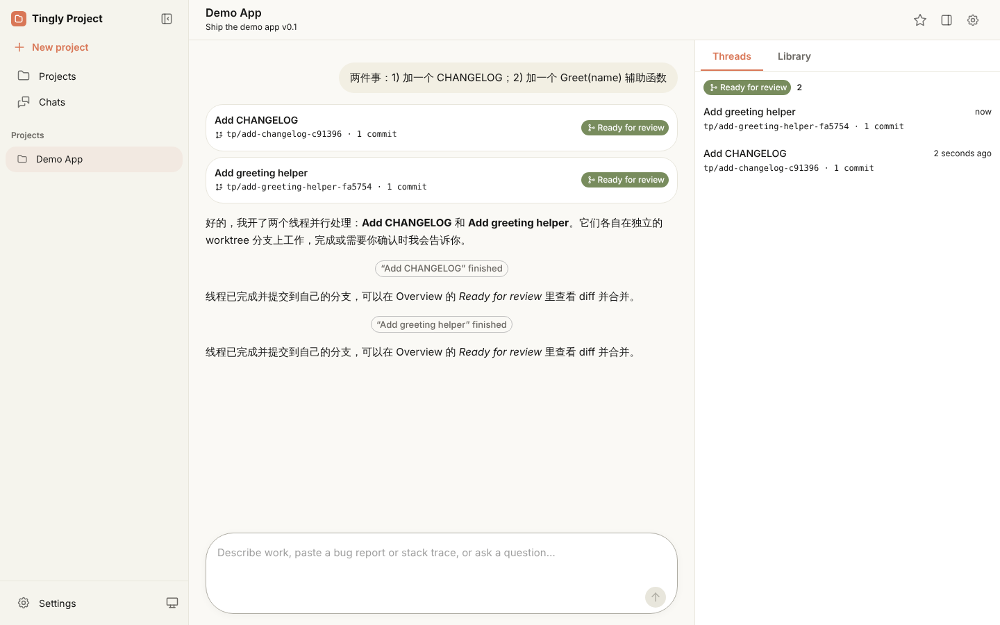
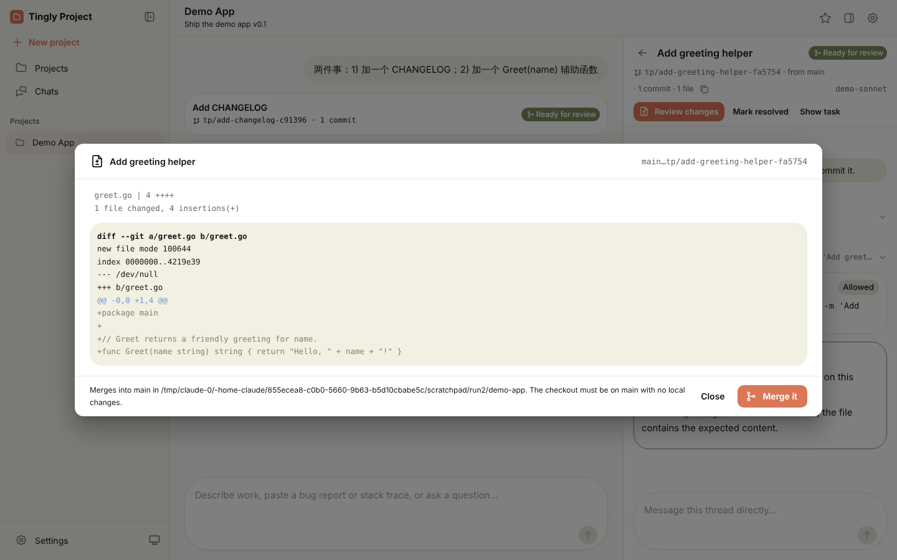
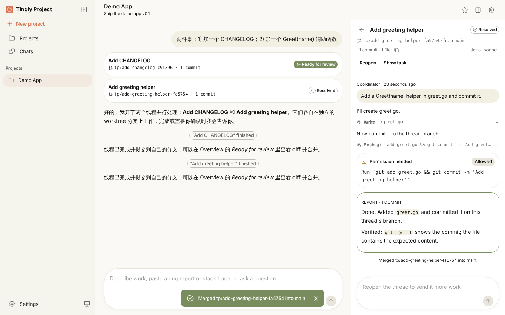

# End-to-end demo

The whole Projects loop on a scratch repository, with a scripted model so it
runs offline and needs no API key: one message in, two parallel threads,
approve their commits, review a diff, merge.

## Run it

Needs `git`, `python3`, the [Claude Code CLI](https://docs.claude.com/en/docs/claude-code)
on `PATH`, and a built `bin/tingly-project` (`task build`; `run.sh` builds it if missing).

```bash
showcase/e2e-demo/run.sh      # prints the project URL, repo path and how to stop it
```

Open the printed URL and follow the steps below by hand, or let Playwright
drive the UI and refresh the screenshots:

```bash
node showcase/e2e-demo/drive.cjs http://127.0.0.1:12590/project/<id>
```

`run.sh` puts everything (repo, database, logs) in a temp directory; set `WORK`,
`PORT` (default 12590) or `MOCK_PORT` (default 12581) to change that.

## What happens

1. The message "两件事：1) 加一个 CHANGELOG；2) 加一个 Greet(name) 辅助函数" goes to
   the coordinator, which starts two threads, **Add CHANGELOG** and **Add greeting
   helper**, each on its own `tp/...` branch and worktree.
2. Each thread writes its file (allowed by `acceptEdits`) and then asks to run
   `git commit`, so both cards show **Waiting on you**.
   
   
3. **Allow once** in each thread: they commit, report back, move to **Ready for
   review**, and the coordinator posts an update.
   
4. **Review changes** shows the branch diff; **Merge it** merges into `main` of
   the demo repo and resolves the thread.
   
   

## The scripted model

[`mock_anthropic.py`](mock_anthropic.py) serves the Anthropic Messages API
(streaming and not, plus `/v1/models` and `count_tokens`). It recognises
coordinator turns by their system prompt and thread turns by the Claude Code
tools, and plays a fixed script: the coordinator calls `start_thread` twice;
each thread calls `Write`, then `Bash` to commit, then reports. Everything else
in the loop (coordinator tool handling, worktrees, the real Claude Code CLI,
permission prompts, diff and merge) is the real product.

To run the same flow against a real model, skip `run.sh`: start Tingly Box,
paste its model token in **Settings**, create a project on any repository and
send the same message.
